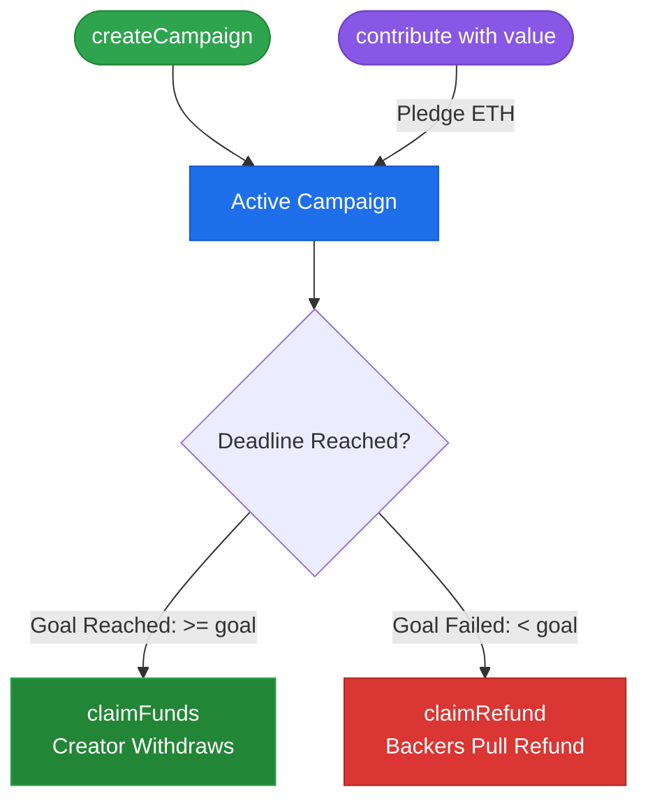

# 🚀 Decentralized Crowdfunding Platform

An EVM-compatible crowdfunding smart contract system that implements an **all-or-nothing** funding model entirely on-chain. Built with Solidity `^0.8.20` and tested, benchmarked, and deployed using the **Foundry** toolchain.

---

## 📋 Table of Contents
- [Overview](#-overview)
- [Core Architecture & Mechanics](#-core-architecture--mechanics)
- [Security Implementations](#-security-implementations)
- [Project Layout](#-project-layout)
- [Getting Started](#-getting-started)
  - [Prerequisites](#prerequisites)
  - [Installation](#installation)
  - [Build](#build)
- [Testing & Quality Assurance](#-testing--quality-assurance)
  - [Running Tests](#running-tests)
  - [Gas Benchmarking](#gas-benchmarking)
  - [Test Coverage](#test-coverage)
- [Deployment Guide](#-deployment-guide)
  - [Local Deployment (Anvil)](#local-deployment-anvil)
  - [Testnet Deployment (Sepolia)](#testnet-deployment-sepolia)
- [Contract Interface & Functions](#-contract-interface--functions)
- [License](#-license)

---

## 💡 Overview

This project provides a trustless, intermediary-free crowdfunding protocol where creators can launch funding campaigns with specific financial targets and timelines. 

- **Target Met:** If the funding goal is reached before the deadline, the creator can withdraw 100% of the pooled ETH.
- **Target Missed:** If the deadline lapses without reaching the goal, the campaign enters a refund state, allowing individual backers to claim their entire contribution back trustlessly.

---

## ⚙️ Core Architecture & Mechanics



1. **Multi-Campaign Registry**: Multiple campaigns run independently within a single deployed contract instance, saving gas compared to a factory-cloning architecture.
2. **Pull-Over-Push Payments**: Refunds are claimed by individual backers rather than iterated via a loop. This avoids block gas limit exhaustion (Denial of Service) attacks.
3. **Time-Warping Validation**: Uses strict Unix timestamp checks (`block.timestamp`) to evaluate campaign active status vs. settlement phase.

---

## 🔒 Security Implementations

* **Checks-Effects-Interactions (CEI)**: State variables (such as zeroing out contributor balances in `claimRefund`) are updated before any external ETH transfer occurs.
* **Custom Reentrancy Guard**: State changes are protected against malicious fallback executions via a mutual exclusion lock (`nonReentrant` modifier).
* **Native Transfer Safety**: Employs low-level call syntax (`call{value: ...}("")`) instead of deprecated `.transfer()` or `.send()`, ensuring forwards-compatibility with gas schedule adjustments.

---

## 📂 Project Layout

```text
.
├── foundry.toml                # Foundry configuration profile
├── src
│   └── Crowdfunding.sol        # Main platform smart contract
├── script
│   └── DeployCrowdfunding.s.sol# Deployment script
└── test
    └── Crowdfunding.t.sol      # Unit and fuzz testing suite